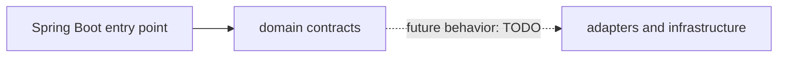

# Package structure

> The Java code uses a single application module with separate `domain` and `application` packages. The root package holds the Spring Boot entry point.

## Flow

<!-- Prefer a mermaid diagram; GitLab and GitHub render it natively. Example: -->

## Key classes / entry points

| Class | Role |
|-------|------|
| `SocialApiAdapterApplication` | Spring Boot entry point in the root package. |

## Business rules

- The current app contains structure only. Define runtime rules in an approved SDD.

## Decisions and trade-offs

- Java 21 + Spring Boot 3.4.5 + Maven; see `docs/sdd/bootstrap-skeleton/spec.md`.

## Gotchas

- No business behavior, persistence, broker, endpoints, or external calls exist yet.

## Related

- [[social-post-normalization]], `docs/sdd/bootstrap-skeleton/spec.md`
