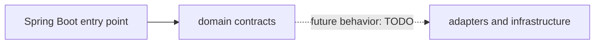

# Social API Adapter domain

> Synthetic source formats are intended to map into one provider-independent `NormalizedSocialPost` model. Fixture adapters and persistence are TODOs; no live provider integration exists.

## Flow

<!-- Prefer a mermaid diagram; GitLab and GitHub render it natively. Example: -->

## Key classes / entry points

| Class | Role |
|-------|------|
| `SocialApiAdapterApplication` | Initial scaffold type; behavior is not implemented. |
| `NormalizedSocialPost` | Initial scaffold type; behavior is not implemented. |
| `SocialSourceAdapter` | Initial scaffold type; behavior is not implemented. |

## Business rules

- The current app contains structure only. Define runtime rules in an approved SDD.

## Decisions and trade-offs

- Java 21 + Spring Boot 3.4.5 + Maven; see `docs/sdd/bootstrap-skeleton/spec.md`.

## Gotchas

- No business behavior, persistence, broker, endpoints, or external calls exist yet.

## Related

- [[domain-structure]], [[social-post-normalization]], `docs/sdd/bootstrap-skeleton/spec.md`
